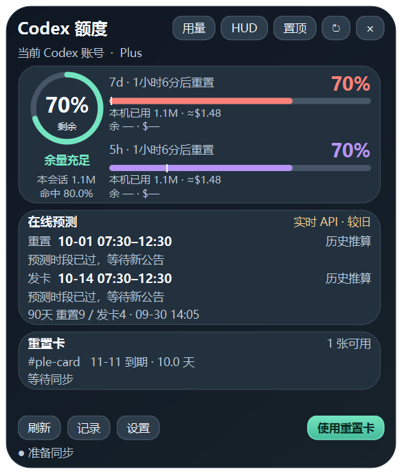

# Codex Quota Viewer

一个面向 Windows 的 Codex 额度查看器与桌面悬浮小组件。

[](https://github.com/Le672/codex-quota-viewer/releases)
[](https://github.com/Le672/codex-quota-viewer/actions/workflows/codex-quota-release.yml)
[](LICENSE)

## 功能

- 显示 Codex 5 小时与每周额度、重置倒计时和重置卡。
- 统计本会话、5 小时窗口和每周窗口的 tokens。
- 分开显示输入、缓存命中输入、缓存未命中输入和输出，并计算缓存命中率。
- 按 OpenAI API 定价提供 tokens 金额等值估算。
- 支持纯透明、玻璃和实色材质，背景不透明度与字体颜色可调。
- 支持置顶、仅留托盘、HUD、小窗口、鼠标穿透和窗口位置记忆。
- 可跟随 Codex 桌面应用启动和退出；网络失败时保留上次数据。




## 安装

从 [Releases](https://github.com/Le672/codex-quota-viewer/releases) 下载最新 Windows 压缩包，解压后运行：

```powershell
powershell -ExecutionPolicy Bypass -File .\install.ps1
```

安装包已经包含可执行程序，不需要另外安装 Python。首次使用前，请确保 Codex 桌面应用已经登录。安装脚本会创建桌面和开始菜单入口，并注册 Codex 启停联动任务。

## 使用方式

启动后，额度查看器会显示在桌面上。默认只有按钮接收鼠标，文字、图表和空白区域会穿透到下面的应用；需要拖动窗口时，可从托盘菜单进入“移动窗口”。

- **用量**：查看本会话、5 小时和每周的详细 tokens 拆分。
- **设置**：调整透明度、颜色、置顶、HUD、穿透和自动刷新。
- **记录**：查看本地采样、额度变化、在线预测和诊断信息。
- **托盘菜单**：显示窗口、刷新、切换 HUD、移动窗口或退出。

## Tokens 统计口径

数据读取自本机 Codex 会话日志，不会上传会话内容：

| 项目 | 含义 |
| --- | --- |
| 输入 tokens | 请求输入总量 |
| 缓存命中输入 | 被缓存复用的输入量 |
| 缓存未命中输入 | 输入总量减去缓存命中量 |
| 输出 tokens | 模型输出量 |
| 缓存命中率 | 缓存命中输入 ÷ 输入总量 |

美元金额是按 API 价格折算的参考值，不是订阅账户的实际账单。没有匹配到公开价格的模型会标记为待估。

## 隐私与安全

- 只读取本机 Codex 登录状态、额度响应和会话 token 统计字段。
- 不读取或上传会话正文、提示词、代码内容和 API 密钥。
- 在线预测请求只访问公开预测接口。
- 重置卡只有在用户明确点击确认后才会提交使用请求。

## 开发与验证

```powershell
python -m pip install -r requirements.txt
python tools/verify_backend.py
python tools/verify_token_details_ui.py
python run.py
```

Windows 打包：

```powershell
build.bat
```

完整验收记录见 [VERIFICATION.md](VERIFICATION.md)，变更记录见 [CHANGELOG.md](CHANGELOG.md)。每次推送 `quota-v*` 标签时，GitHub Actions 会执行检查、构建 Windows x64 压缩包并生成 SHA256 校验文件。

## 当前版本

[v1.10.0](https://github.com/Le672/codex-quota-viewer/releases/tag/quota-v1.10.0)

## 许可

[MIT License](LICENSE)
