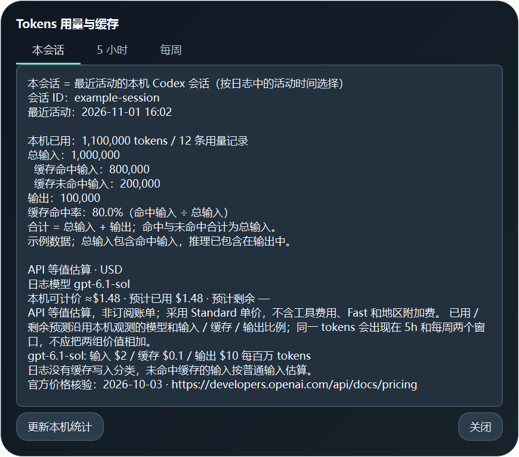

# Codex 额度查看器 v1.10.0

**[下载 Windows 发行包](https://github.com/Le672/codex-quota-viewer/releases/tag/quota-v1.10.0)** · [独立源码仓库](https://github.com/Le672/codex-quota-viewer)

解压发行包后执行 `install.ps1` 安装；无需另装 Python。首次使用需要本机 Codex 已登录。



Windows 桌面 widget，显示当前登录账号的 5 小时与每周剩余额度、自然重置倒计时、可用重置卡，以及 AIHOT 在线重置 / 发卡预测。

界面参考 [codex-quota-widget](https://github.com/stupdada/codex-quota-widget) 的圆角面板、额度环和紧凑 HUD；使用 Qt / PySide6 原生按钮。默认采用纯透明背景，保留额度、tokens 预测与 AIHOT 在线预测；也可切换玻璃或实色材质。

## 使用

双击 `dist\Codex额度查看器.exe`，或执行 `install.ps1` 安装到当前用户程序目录。安装会创建桌面和开始菜单快捷方式；再次打开会显示已运行的窗口。

```powershell
powershell -ExecutionPolicy Bypass -File .\install.ps1
```

安装默认启用 Codex 桌面联动，并登记当前用户的 `CodexQuotaViewer-FollowCodex` Windows 计划任务。任务在本用户登录时以交互令牌、普通权限运行，无执行时限，电池供电时也继续等待；意外失败可重启。由任务服务创建联动器，独立于 Codex 和启动命令的进程组。Codex 未运行时，额度窗口和托盘不显示；检测到桌面打开后启动查看器，桌面关闭后约 2～4 秒保存设置并退出。已经运行的 Codex 会立即接入，无需重启桌面应用。

联动器识别 `OpenAI.Codex` 安装包内的主程序及实际桌面窗口，兼容包版本更新；CLI、渲染器、GPU、crashpad 和 sandbox service 不会阻止查看器退出。排除工具主窗口关闭后留下的最小化任务栏代理窗口；关闭窗口但后台进程继续运行时也会结束查看器。同一进程重新打开桌面窗口时恢复联动。多个桌面实例需要全部关闭才退出查看器。短暂更新重启保留窗口；从查看器托盘主动退出后，本次桌面会话不会反复重开。

联动启动直接显示窗口，不改动“手动启动时直接进入托盘”的偏好；HUD、置顶、鼠标穿透、字体、材质和价格设置沿用现有选择。查看器随退出正常保存设置。登录后等待 Codex 的联动进程不建窗口、不建托盘、不加载 Qt，也不读取登录凭据或请求额度 API。

窗口自动记住最后位置。拖动结束、关闭到托盘、退出查看器和 Codex 联动退出都会保存；下次启动与托盘恢复沿用该坐标，HUD 与完整面板切换不重新居中。首次无位置记录时居中，旧位置因显示器移除而离屏时移回最近的可见区域；位置使用 Qt 逻辑坐标保存，兼容高 DPI。

手动打开已安装的查看器会恢复已登记但停止的联动任务；旧的登录快捷方式已迁移为计划任务。源码可用 `python run.py --watch-codex` 启动联动，`--follow-codex` 是后台打开窗口的参数。需要恢复独立运行时，重新执行 `install.ps1 -NoCodexFollow`，会移除本应用任务；添加 `-AutoStart` 可保留传统登录后最小化启动方式。

安装版使用 `%USERPROFILE%\.codex-quota-viewer` 共享设置和联动状态，避免 Codex 的 MSIX 应用包把 AppData 重定向到自己的缓存副本。首次由独立任务迁移旧设置和本程序缓存，已有共享设置不覆盖；旧目录保留。无自动安装标记、显式覆盖 APPDATA 或隔离测试时，继续使用原来的 AppData 目录。

任务栏、窗口、托盘及快捷方式统一使用深蓝圆角底、蓝紫 / 薄荷双额度环图标，提供 16～256 像素共 11 个尺寸。安装更新本应用快捷方式图标并通知 Windows 刷新。矢量源在 `assets/icon.svg`，通过 `python tools/make_icon.py` 生成 ICO 与预览。

- **HUD / 展开**：在紧凑条和完整面板间切换；默认只有按钮接收鼠标，文字、图表与背景穿透到下方软件。需要移动时，从托盘选择“移动窗口”，拖动标题，再选择“锁定并恢复穿透”或按 Esc。
- **额度**：绿色额度环显示最低剩余，紫色为 5 小时、珊瑚色为每周；进度条白线表示按当前窗口剩余时间计算的理想剩余额度。
- **Tokens**：两组额度分别显示预计已使用 / 剩余 tokens，后面显示按官方 API 单价折算的美元价值；样本不足时仅显示本机已观测用量。记录显示输入、缓存输入、输出、模型与价格依据。
- **用量**：顶部按钮在完整面板与 HUD 中均可用；分页显示本会话、5 小时、每周的总输入、缓存命中输入、未命中输入、输出及缓存命中率，保留精确整数与 API 等值估算。
- **在线预测**：分别显示下次重置和发卡窗口、预测来源、倒计时、90 天次数及 AIHOT 核验时间；最近事件通过卡片悬停提示及记录查看。
- **刷新**：后台读取当前 Codex 登录账号；其他操作仍可使用。`Ctrl+R` 同样刷新。
- **记录**：查看采样、完整卡片与建议、社区历史和诊断；可重新扫描本地记录。
- **设置 → 外观**：主题、材质、背景不透明度及八项文字配色；实时预览，保存后记住选择，取消恢复原样。
- **设置 → 常规**：置顶、仅留托盘、鼠标穿透、HUD、启动与关闭行为、在线预测、额度数据源及自动刷新。间隔为 30～3600 秒，0 关闭。
- **设置 → 价格**：显示 / 隐藏美元价值，自动按日志模型分别计价，或指定一个模型折算；查看已核验单价、日期与来源。
- **使用重置卡**：选择卡片并点击“确认使用”才会提交；关闭或取消弹窗不发送请求。
- **托盘**：关闭可收进托盘，托盘菜单支持显示、刷新、HUD、任务栏模式、设置和退出。启用“悬浮显示，仅留托盘”后，窗口仍可前台显示和置顶，任务栏没有程序按钮；单击托盘图标可恢复窗口。托盘不可用时保留普通窗口入口。

完整面板默认 390×460，HUD 为 390×170（Qt 逻辑像素）；150% 屏幕缩放时分别约 585×690 和 585×255 像素。额度、两项在线预测、到期最早的两张重置卡、用卡建议与底部按钮集中在首屏。使用节奏位于额度环下方；完整建议、最近事件和卡片标识通过悬停提示或“记录”查看，卡片选择弹窗包含全部卡片。

底部操作栏固定；默认穿透模式下，滚轮也会传到下方软件。需要滚动较长正文时，关闭穿透，或在“记录”查看全部详情。刷新失败保留上一份数据并标明状态。

## 鼠标穿透

Windows 主展示窗口使用 `Qt.WindowTransparentForInput`（layered + `WS_EX_TRANSPARENT`），因此文字、图表与底色即使不透明也不会占用点击区域。独立 Tool 窗口用原生区域裁剪，仅覆盖可见按钮，将输入转发给原有 Qt 按钮；不使用全局鼠标钩子，也不轮询切换穿透样式。完整面板和 HUD 都支持；按钮之间的空白同样穿透。

设置、记录和卡片等弹窗保留正常输入。收进托盘、弹窗显示或进入移动模式时隐藏按钮输入层；窗口恢复后同步位置与按钮区域。用户可从设置或托盘关闭穿透，恢复原有整窗交互。

实现依据：[Microsoft layered windows](https://learn.microsoft.com/en-us/windows/win32/winmsg/window-features)、[Qt WindowTransparentForInput](https://doc.qt.io/qt-6/qt.html)。

## 透明与玻璃材质

默认纯透明：关闭 Windows 原生模糊，移除底色、渐变和光晕，只保留文字、图表和细边框。背景不透明度可调 0～100%，0% 为纯透明，100% 为实色，使用当前深浅主题的底色。最小 alpha 用于绘制与按钮输入窗口的命中；主展示窗口是否穿透由独立窗口标志控制，与背景浓度无关。底色只在最外层绘制一次，卡片不会重复叠加设定浓度。完整面板尺寸仍为 390×460，HUD 为 390×170。

设置可以切换纯透明、液态玻璃 / 亚克力或实色。玻璃模式由 Windows 合成器处理窗后背景，Qt 叠加透光底色、反光和高光边缘。主面板、HUD、设置、记录和卡片弹窗使用同一套材质。

设置可切换深浅主题；玻璃模式可调底色浓度。浓度只改变底色，窗口整体透明度保持 100%，文字和图标不会跟着变淡；不重建原生按钮。标题区域可拖动窗口或弹窗。

透明模式使用独立背景不透明度滑块，玻璃模式使用独立底色浓度滑块。窗口标题、正文 / 按钮、辅助文字 / tokens、每周额度、5 小时额度、正常状态 / 节奏、警告与告急文字可分别选色，支持颜色选择器及 #RRGGBB 输入；额度配色同时作用于对应进度条。可一键恢复当前主题默认配色。预览只改变显示，取消不会写入偏好；修改外观不会触发额外网络刷新。

普通窗口使用文档化的 DWM Desktop Acrylic；Qt 逐像素透明窗口使用 DWM Accent Acrylic 兼容路径。原生接口不可用时回退到实色玻璃表面，不修改 Windows 全局透明效果设置。

`--screenshot` 导出 Qt 界面前景，不包含由系统生成的窗后模糊层。截图中的渐变和高光属于实际控件绘制。

## Tokens 统计与预测

本会话按日志中的最近活动时间自动选择，完整面板额度环下方与 HUD 摘要显示本会话 tokens 和缓存命中率；点击顶部“用量”可核对会话 ID 和最后活动时间。多个会话并行时，显示最近活动的会话，不代表当前前台标签。新会话没有用量样本时显示“—”。本机会话统计每 15 秒在后台增量刷新，不额外请求额度接口。

缓存命中率为 `缓存命中输入 / 总输入`，不是请求次数命中率；未命中为 `总输入 - 缓存命中输入`，总 tokens 为 `总输入 + 输出`，命中输入不重复相加。输入为 0 时命中率显示“—”。本会话独立于额度重置累计可观测请求；累计计数重启时继续累加新增请求，不把 fork 继承的历史计数冒充本会话新消耗。日志不存在或记录被删除时无法补出此前数据。

读取本机 `%USERPROFILE%\.codex\sessions` 的 `token_count` 事件（支持 `CODEX_HOME`），按当前 5 小时和每周窗口筛选。扫描仅保留 token / 额度字段；后续刷新只读取新增数据，在后台执行。忽略自定义 provider、无订阅额度的事件、其他额度桶、不同套餐和过期周期；fork 复制的事件去重，处理累计计数重启、重复事件、写入半行及重置卡造成的额度清零。

总 tokens 为输入 + 输出。缓存输入已经包含在输入，推理输出已经包含在输出，不重复相加。本机观测无法覆盖其他设备、云端、删除的记录或不同账号但缺少账号标识的历史；统计明确标注本机范围。

订阅额度不是固定 token 上限。[OpenAI 官方文档](https://learn.chatgpt.com/docs/pricing)说明，模型、上下文、推理、工具使用和缓存都会影响额度。应用根据同一窗口内的 token 增量 / 额度百分点变化进行标定，再乘当前已使用 / 剩余百分比。至少需要 3 个额度点、5 个百分点变化和 60 秒跨度，最后有效样本需在 30 分钟内；不满足条件时显示待估，不提供虚构的上限。预测沿用近期使用组合，用“≈”标记，不参与重置卡消费建议。

完整观测和标定依据位于“记录”，HUD 同时保留精简数值。`--json` 包含 `tokens` 和 `token_values` 字段。

## Tokens 美元价值

按 [OpenAI 官方定价](https://developers.openai.com/api/docs/pricing)的 Standard API 单价计算，2026-10-03 核验，支持 GPT-6.1 Sol、GPT-6 系列、GPT-5.6 系列、GPT-5.5、GPT-5.4 和 GPT-5.3 Codex。价格模块保留每个模型的官方模型页来源。默认读取日志 `turn_context.model`，混用模型分别计价；可在设置指定模型作对比估算。部分模型没有公开报价时，本机价值显示可计价部分的下界（≥）；已用 / 剩余预测沿用其余已识别模型的输入、缓存、输出比例，并在记录中说明缺价模型与 tokens。没有任何可定价样本时显示 $—，不静默替换未知模型。

本机价值为 `普通输入 × 输入单价 + 缓存输入 × 缓存单价 + 输出 × 输出单价`，除以一百万。缓存输入是输入的子集，推理已包含在输出，均不重复相加。有缓存写入字段时，从普通输入中扣除该部分并使用写入单价；字段缺失时按普通输入估算并注明。具体规则见 [官方 prompt caching 文档](https://developers.openai.com/api/docs/guides/prompt-caching)。

记录提供单次输入长度时，对支持长上下文阶梯的模型应用 >272K 输入的价格倍率。已用 / 剩余预测价值按本机观测的美元 / token 比例缩放，保留“≈”；没有可靠 token 标定时，不虚构剩余价值。两组窗口包含重叠用量，其价值不能相加。

数值表示 API 等值估算，不是订阅实际账单；美元计价，不包含 Fast、地区附加费及工具费用。定价为已核验版本，不在每次刷新时额外联网下载。小于一美分仍保留有效数位。价格显示、取消及保存不触发额度网络刷新。

## AIHOT API 与预测含义

使用公开 [codex-resets API](https://aihot.news/api/v1/codex-resets)，接口说明见 [AIHOT API 文档](https://aihot.news/agent?tab=api)。该请求不包含 Codex 账号凭据。

首次下载完整历史，随后每 5 分钟按需请求 `/api/v1/codex-resets/recent`，使用 gzip 和 ETag / 304。完整历史按设置的缓存时长刷新；近期快照会替换窗口内旧记录，应用历史更正与撤回。失败时标明缓存及其时间；没有有效数据时显示不可用。

有明确预告时显示“原帖预告”；接口提供估计窗口时显示“AIHOT 模型”。没有待执行事件时，使用已确认事件的间隔进行“历史推算”，属于统计参考，不保证发生。确认帖时间不冒充准确到账时间，已完成或过期预告不当作未来公告。历史推算不会作为等待官方重置、消费重置卡的判断依据。

## 源码运行与构建

使用 Windows Python 3.10 或更高版本，先安装 Qt 运行库：

```powershell
python -m pip install -r requirements.txt
python run.py
python run.py --minimized
python run.py --json --output snapshot.json
python run.py --screenshot preview.png
python run.py --selftest
python -m unittest discover -s tests -p "test_*.py"
python tests\test_ui_smoke.py
```

`--screenshot` 在首次刷新完成后保存程序自身窗口的 PNG，窗口保持运行。Qt 交互测试使用临时设置目录、公开 API 样本与模拟后台，不读取账号凭据、不消费真实卡片。

构建执行 `build.bat`，或安装 PyInstaller 后运行 `python -m PyInstaller CodexQuotaViewer.spec`。生成 `dist\Codex额度查看器.exe` 和 `dist\Codex额度联动.exe`；两者放在同一目录，安装脚本一起安装。联动程序独立打包，不包含 Qt。EXE 包含所需 Python / Qt 运行库，目标电脑无需另装运行库。

## 数据

额度直接读取当前 `%USERPROFILE%\.codex\auth.json`（支持 `CODEX_HOME`），通过 HTTPS 请求现有 ChatGPT 接口。安装版设置、日志和事件缓存在 `%USERPROFILE%\.codex-quota-viewer`；设置中的“数据目录”可打开该位置。未安装及显式 APPDATA 覆盖使用 `%APPDATA%\CodexQuotaViewer`。

无控制台 EXE 的 `--json` 默认写入数据目录的 `last-snapshot.json`，可用 `--output` 指定路径。JSON 和窗口截图包含账号标识，分享前请检查。验收细节见 [VERIFICATION.md](VERIFICATION.md)。
